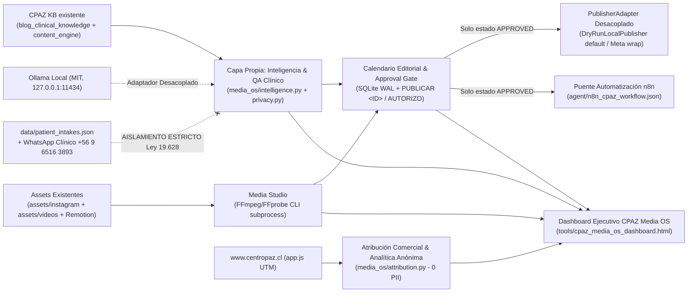

# CPAZ Media OS — Auditoría, Matriz Comparativa OSS y Arquitectura Seleccionada

**Fecha:** 2026-11-11  
**Proyecto:** Centro Paz (`centro-paz` / `www.centropaz.cl`)  
**Rama:** `feat/cpaz-media-os`  
**Regla Rectora:** `INVESTIGAR ANTES DE CONSTRUIR. INTEGRAR ANTES DE DUPLICAR. MEDIR ANTES DE AFIRMAR. OPTIMIZAR ANTES DE ESCALAR.`

---

## 1. Auditoría de Estado Actual (`centro-paz` @ `main` `50e1293`)

Antes de seleccionar herramientas externas, se auditó físicamente el repositorio `/Users/nigoku/Proyectos/centro-paz`:

| Capacidad | Activos/Módulos Existentes Auditados | Estado Real | Veredicto Reutilización |
| :--- | :--- | :--- | :--- |
| **Base Clínica y Contenidos** | `agent/blog_clinical_knowledge.py` (`CLINICAL_ARTICLES`, 28 temas), `agent/content_engine.py` (`TOPICS` 28 piezas, `REELS_SCRIPTS` 7 guiones, `THREADS_POSTS` 3 hilos, `FACEBOOK_COMMUNITY_POSTS`, calendario 4 semanas). | Completo, validado con identidad NAP/SIS Nº `667344`. | **REUTILIZAR 100%** como fuente de verdad de tópicos. |
| **Generación Gráfica** | `agent/marketing_agent.py` (HTML -> Chrome Headless PNG 1080×1350) + `assets/instagram/` (28 `.html` + 28 `.png`). | Activos renderizados y funcionales en disco. | **REUTILIZAR 100%** (sin instalar Canva-clones ni GPUs). |
| **Motor de Video** | `video_engine/generate_short_remotion.py` (Remotion + `edge-tts` `es-CL-CatalinaNeural` + `faster-whisper`) + `assets/videos/` (11 `.mp4`, incl. `cpaz_short01_tdah_remotion.mp4`). `video_engine/public/voice_short01.mp3` sin versionar. | Funcional; **preservar `video_engine/public/` intacto**. | **REUTILIZAR** + enriquecer con `ffmpeg`/`ffprobe` CLI local. |
| **Publicación Social** | `agent/auto_publisher.py` (Meta Graph API multi-slot feed/reel + `--dry-run`). **Brecha detectada:** carece de máquina de estados de aprobación humana (`PUBLICAR <ID>`/`AUTORIZO`) por ítem; además `VIDEOS_CATALOG[2]` tiene typo menor en arancel copiado (` .000`). | Riesgo si se conectara token vivo sin gate humano. | **ENVOLVER CON GATE ESTRICTO** (`ApprovalRequiredError` + dry-run default). |
| **Automatización** | `agent/n8n_cpaz_workflow.json` + instancia **n8n ya activa en Oracle VPS** (`n8n-n8n-1:5678`). **Brecha detectada:** el workflow actual lee un catálogo plano sin exigir filtro `APPROVED`. | Sin cron productivo conectado aún a Meta. | **REUTILIZAR `n8n` existente** vía exportador aprobado-only. |
| **Atribución Web** | `app.js` (`getUTMContext()` y `trackCPAZEvent()` para `utm_source`, `utm_campaign`, `utm_medium`, `utm_content`, `ref`, `c` en WhatsApp CTA `+56 9 6516 3893`). | Implementado en web estática GitHub Pages (`www.centropaz.cl`). | **COMPATIBILIZAR** con generador UTM y ledger anónimo SQLite. |
| **Datos Clínicos** | `data/patient_intakes.json` (`patients: []`, gitignored) y `agent/patient_intake_manager.py`. | Estándar clínico privado Ley N° 19.628. | **AISLAMIENTO ABSOLUTO** (CPAZ Media OS tiene prohibido leer/escribir este archivo). |
| **Tests Existentes** | `agent/test_full_suite_e2e.py` (**7/7 PASS**, 54 páginas HTML), `agent/audit_directory_consistency.py` (**64/64 PASS**). | Verde al 100%. | **MANTENER VERDE 100%**. |

---

## 2. Presupuesto de Infraestructura Verificado (Restricción Física)

- **Mac local (entorno autorizado actual):** Apple Silicon **8 GB RAM unificada** (8 CPU cores), ~6 GiB libres de disco al inicio, Python 3.14, `ffmpeg 8.1.1` + `ffprobe` (Homebrew), `npx` (Node/Remotion), **Ollama activo en `127.0.0.1:11434` con `qwen2.5-coder:1.5b` (986 MB)**. Sin demonio Docker instalado.
- **Oracle VPS (`oracle-ironcross`):** **954 MiB RAM totales (~340 MiB libres)** ejecutando `n8n`, `n8n-postgres-1`, `nicola-finanzas-agent`, `wa-waba-router`, `baileys-encuestas`, `voz-live`, `ironcross-app` y `nicola-os-dashboard`. **Prohibido desplegar contenedores pesados sin medir ni autorizar.**

---

## 3. Matriz Comparativa Open Source y Revisión de Licencias

| Proyecto / Herramienta | Capacidad Principal | Stack / Huella RAM | Licencia | Obligaciones / Riesgos Legales y Operativos | Decisión CPAZ Media OS |
| :--- | :--- | :--- | :--- | :--- | :--- |
| **OpenPost** (`getopenpost/openpost`) | Estudio gráfico/carrusel/video + scheduling + MCP `openpost-agent-plugin`. | TS + Go + Svelte + SQLite / Docker (~500–900 MB). | **AGPL-3.0** | Copyleft de red fuerte: si se expone como servicio en red modificado, obliga a liberar código completo bajo AGPL-3.0. Duplica `marketing_agent.py` + `video_engine`. | **Contrato adaptador futuro (deshabilitado)**. No instalar en MVP ni en Oracle. |
| **BrightBean Studio** (`brightbeanxyz/brightbean-studio`) | Estudio social self-hosted (10+ APIs), Kanban editorial, calendario drag-and-drop y links de aprobación por 30 días. | Python / Django 5 + HTMX + Postgres (~500 MB–1.5 GB). | **AGPL-3.0** | Requiere Django + Postgres adicional; copyleft AGPL-3.0 si se opera como SaaS multiusuario. Solapa calendario/aprobaciones sin aportar QA clínico CPAZ ni aislamiento de fichas. | **Referencia arquitectónica + contrato adaptador externo opcional detrás de VPN**. No duplicar stack. |
| **Postiz** (`gitroomhq/postiz-app`) | Programación multicanal, analíticas, workflows sociales completos. | Next.js + NestJS + Postgres + Redis + Temporal (**2–8 GB RAM**). | **AGPL-3.0** | Inválido en Oracle Free Tier (340 MiB libres) y satura Mac de 8 GB junto a Chrome/Remotion. Exige Docker Compose multipieza + copyleft de red AGPL-3.0. | **DESCARTADO para runtime local/Oracle**. Se mantiene interfaz `ExternalOSSPublisherContract` deshabilitada. |
| **Activepieces** (`activepieces/activepieces`) | Automatización visual tipo Zapier con conectores HTTP/AI. | TypeScript + Postgres/PGLite + Redis (**2–4 GB RAM**). | **MIT (core)** + EE propietario en `packages/ee/` | Duplicaría **n8n** que **ya corre 24/7 en Oracle** (`agent/n8n_cpaz_workflow.json`). Correr otro motor consume >=2 GB RAM innecesarios. | **DESCARTADO como servidor**. `media_os/automation.py` emite payloads compatibles con n8n y webhook Activepieces solo para ítems `APPROVED`. |
| **Ollama** | Inferencia LLM 100% local en Mac (`127.0.0.1:11434`). | Binario nativo ya activo (~1.1 GB con `qwen2.5-coder:1.5b`). | **MIT** | Licencia permisiva sin copyleft. **Costo `$0/mes`**, cero envío de contexto fuera del Mac. Debe filtrarse entrada previa sin PII (Ley 19.628). | **SELECCIONADO** vía adaptador desacoplado (`OllamaAdapter`) con fallback determinista offline. |
| **ComfyUI** (`comfyanonymous/ComfyUI`) | Generación de imágenes/video por difusión nodal (SDXL/Flux). | Python + PyTorch + pesos (**16–32 GB RAM/VRAM**). | **GPL-3.0** | Satura Mac de 8 GB, imposible en Oracle; imágenes sintéticas conllevan riesgo estético/ético en clínica de salud mental. GPL-3.0 restringe vinculación cerrada. | **DESCARTADO del runtime por defecto**. Solo contrato HTTP deshabilitado (`ComfyUIAdapter`) para uso futuro en máquina GPU si se autoriza. |
| **FFmpeg** (`ffmpeg` / `ffprobe` v8.1.1 local) | Inspección, recorte, miniaturas, normalización y transcodificación A/V. | CLI binario (~0 MB RAM en reposo). | **GPL-3.0 (`--enable-gpl --enable-version3`)** | Al usarse **exclusivamente mediante subproceso CLI** (`subprocess.run`) sobre entradas/salidas en disco, evita contagio de vinculación GPL en nuestro código Python y ofrece máxima velocidad nativa Apple Silicon (`videotoolbox`). | **SELECCIONADO** como adaptador CLI desacoplado (`MediaStudio`). |
| **Remotion** (`video_engine/`) | Video vertical 1080×1920 programático con React + Whisper + `edge-tts`. | Node.js / Chromium bajo demanda. | **Source-available (Remotion License)** | Gratuito para uso individual y empresas de hasta 3 personas (Centro Paz cumple hoy; revisar licencia comercial solo si el equipo supera 3 personas). | **SELECCIONADO Y REUTILIZADO** desde `video_engine/`. |
| **Mixpost Lite** (alternativa evaluada) | Publicador Laravel para X/Mastodon/FB. | PHP/Laravel + MySQL + Redis. | **MIT** | Versión gratuita Lite **excluye Instagram y TikTok** (requiere Mixpost Pro pago) e introduce stack PHP/MySQL ajeno a Nicola OS. | **DESCARTADO**. |
| **Umami / Shlink** (alternativas analítica/enlaces) | Analítica privacy-first / acortador con UTM. | Node+Postgres (~1 GB RAM) / PHP+DB. | **MIT** | Levantamiento de servidor adicional innecesario en MVP; ya existe `app.js` + `www.centropaz.cl` en GitHub Pages. | **NO INSTALAR SERVIDOR**. Se provee importador de agregados Umami/GA4/Shlink sin PII en `media_os/attribution.py`. |

---

## 4. Arquitectura Mínima Seleccionada (CPAZ Media OS)

Combinación mínima que entrega el **100% de las 10 capacidades solicitadas**, con **0 servidores nuevos pesados**, **`$0/mes` de APIs pagadas** y **cero riesgo AGPL/GPL en producción**:

### Mapa de Capacidades e Interfaces Desacopladas (`media_os/`)

1. **Privacidad y Aislamiento Clínico ([`media_os/privacy.py`](../media_os/privacy.py)):** Firewall estricto contra Ley N° 19.628 (`PrivacyViolationError`) que bloquea RUTs, teléfonos personales (permitiendo solo el canal público oficial `+56 9 6516 3893`), correos clínicos privados y cualquier lectura de `data/patient_intakes.json`.
2. **Inteligencia Estratégica e Investigación ([`media_os/intelligence.py`](../media_os/intelligence.py)):** Reutiliza los 28 temas de `content_engine.TOPICS`, `REELS_SCRIPTS` y `CLINICAL_ARTICLES` con enriquecimiento vía `OllamaAdapter` (MIT) y fallback determinista; ejecuta **QA Clínico / Identidad** verificando Registro SIS `667344`, arancel `$45.000 CLP` (detecta aranceles obsoletos `$40.000`/`$50.000`), WhatsApp oficial y lenguaje neuroafirmativo sin promesas diagnósticas.
3. **Creación Audiovisual y Edición ([`media_os/studio.py`](../media_os/studio.py)):** Sondea con `ffprobe` real duración, resolución y codec de `assets/videos/*.mp4`; ejecuta cortes/miniaturas ligeras vía subproceso `ffmpeg` CLI aislado (sin contaminar `video_engine/public/`) y expone interfaz deshabilitada `ComfyUIAdapter`.
4. **Calendario Editorial + Publicación Controlada ([`media_os/calendar.py`](../media_os/calendar.py), [`media_os/publishers.py`](../media_os/publishers.py)):** Máquina de estados en SQLite WAL (`DRAFT -> CLINICAL_QA -> APPROVED -> SCHEDULED -> PUBLISHED_DRYRUN | REJECTED`). Toda publicación real o encolamiento n8n exige registro explícito `PUBLICAR <ITEM_ID>` / `AUTORIZO <ITEM_ID>` (`ApprovalRequiredError`); el motor activo por defecto es `DryRunLocalPublisher`.
5. **Automatización ([`media_os/automation.py`](../media_os/automation.py)):** Genera payloads JSON compatibles con `agent/n8n_cpaz_workflow.json` (Oracle `n8n`) y webhooks externos, filtrando estrictamente borradores no aprobados.
6. **Analítica y Atribución Comercial sin PII ([`media_os/attribution.py`](../media_os/attribution.py)):** Genera URLs UTM compatibles con `app.js` (`getUTMContext()`), ingesta métricas anónimas + agregados externos (Umami/GA4/Shlink) y mide consultas comerciales atribuidas por campaña/formato y proyección económica (`$45.000 CLP`).
7. **Dashboard Ejecutivo ([`media_os/dashboard.py`](../media_os/dashboard.py) y [`tools/cpaz_media_os_dashboard.html`](../tools/cpaz_media_os_dashboard.html)):** Vista ejecutiva autocontenida (y servidor loopback opcional `127.0.0.1`) que consolida estrategia, producción audiovisual, aprobaciones pendientes, calendario, puente n8n, analítica/atribución y cumplimiento de licencias/privacidad.

---

## 5. Control de Riesgos y Ruta de Rollback

- **Aislamiento Git:** Todo el trabajo vive en la rama `feat/cpaz-media-os`, sin fusionar a `main` ni desplegar en GitHub Pages / Oracle sin `AUTORIZO`.
- **Rollback inmediato:** `git checkout main` (preservando siempre `video_engine/public/` y `data/patient_intakes.json`, ambos intactos) y eliminar `data/media_os/media_os.db` local si se desea reiniciar el estado de pruebas.
